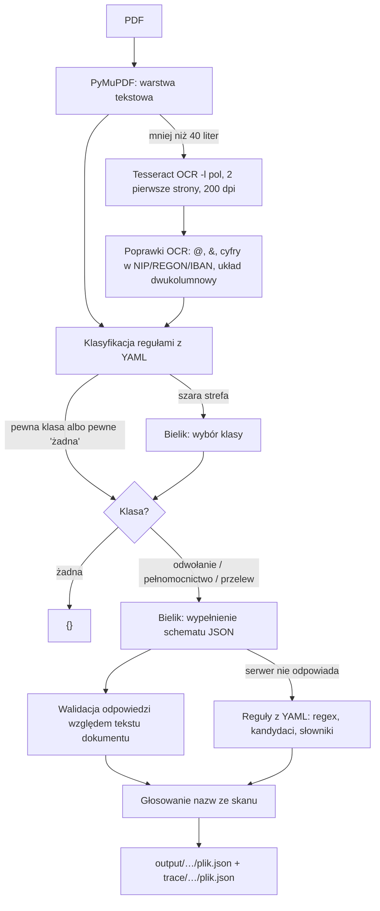

# Dokumentacja techniczna – Odwołania2json (Data Bridge)

Dokument dla osób, które wdrażają, oceniają lub rozwijają projekt. Opisuje, jak program zamienia PDF-y w JSON, jak korzysta z modelu językowego Bielik i co trzeba zmienić, żeby przejść na Bielika udostępnianego przez API.

Szczegóły uzupełniające:
- [architektura.md](architektura.md) – krok po kroku, co dzieje się z tekstem dokumentu,
- [konfiguracja-klasy.md](konfiguracja-klasy.md) – jak dodać lub zmienić klasę dokumentu,
- [README](../README.md) – instalacja i polecenia, [RUN.md](../RUN.md) – komenda dla oceniających.

## 1. Co robi program

Wejście: pliki PDF (tekstowe albo skany) z postępowań przed Krajową Izbą Odwoławczą.
Wyjście: dla każdego PDF-u jeden plik JSON o tej samej nazwie i ścieżce.

Program rozpoznaje trzy klasy dokumentów i dla każdej wypełnia stały schemat JSON:

| Klasa | Plik konfiguracji | Przykładowe pola |
|---|---|---|
| Odwołanie | `config/classes/odwolanie.yaml` | odwołujący, zamawiający, numer postępowania, BZP/TED, data i miejscowość, czynność |
| Pełnomocnictwo | `config/classes/pelnomocnictwo.yaml` | mocodawca, pełnomocnicy, zakres |
| Potwierdzenie przelewu | `config/classes/przelew.yaml` | data operacji, kwota, rachunki, tytuł, numer transakcji |

Każdy inny dokument (wyrok KIO, ogłoszenie, faktura, szkolenie…) dostaje pusty JSON `{}`.

## 2. Układ katalogów

```
/opt/
├── RUN.md        komenda dla oceniających (kopia solution/RUN.md)
├── input/        PDF-y wejściowe, np. input/case1/odwolanie.pdf
├── output/       wyniki, np. output/case1/odwolanie.json
└── solution/     repozytorium
    ├── app/      kod (Python)
    ├── config/   model.yaml, klasy dokumentów, słownik czynności
    ├── docs/     dokumentacja
    ├── tests/    testy pytest
    ├── trace/    ślad ekstrakcji każdego pola (cytat, strona, metoda)
    ├── start.bat, Dockerfile, docker-compose.yml
```

Kod szuka `input/` i `output/` w katalogu nadrzędnym projektu (`ROOT.parent`). W kontenerze projekt leży w `/app`, a compose montuje `../input` jako `/input` i `../output` jako `/output`.

## 3. Sposoby uruchomienia

| Sposób | Polecenie | Zachowanie |
|---|---|---|
| Strona WWW (Windows) | `start.bat` | instaluje Tesseract (winget) i zależności, uruchamia stronę i otwiera przeglądarkę na `http://localhost:8000` |
| Wsad bez okna (Windows) | `start.bat --cli` | przetwarza wszystkie PDF-y z `input/` i kończy |
| Wsad (dowolny system) | `python -m app` | jak wyżej |
| Ocena na VM | `cd /opt/solution && sudo docker compose run --rm -T odwolania2json` | jak wyżej, w kontenerze z Pythonem 3.13 i Tesseractem |

Wymagania: Python 3.13+ (`start.bat` go nie instaluje), Tesseract z językiem polskim dla skanów, dostęp sieciowy do serwera modelu.

## 4. Przetwarzanie jednego dokumentu



| Moduł | Odpowiedzialność |
|---|---|
| `app/extract.py` | tekst z PDF (PyMuPDF), OCR skanów (Tesseract, wynik TSV z pewnością słów) |
| `app/ocr_fix.py` | poprawki tekstu po OCR i głosowanie wariantów nazw |
| `app/classify.py` | punktacja klas wzorcami `positive` / `negative` z YAML |
| `app/llm.py` | klient HTTP modelu (Ollama albo API zgodne z OpenAI) |
| `app/llm_extract.py` | prompty, klasyfikacja w szarej strefie, ekstrakcja przez model i walidacja odpowiedzi |
| `app/engine.py` | cała ścieżka dokumentu, ekstrakcja regułami (zapas), zapis wyników (`process_input`) |
| `app/candidates.py`, `app/normalize.py` | kandydaci na identyfikatory i normalizacja wartości (daty ISO, kwoty, IBAN…) |
| `app/ui.py` | strona WWW |
| `app/score.py` | lokalny F1 względem danych organizatora (poza ścieżką ocenianą) |

Plik uszkodzony albo nieczytelny nie przerywa wsadu: dostaje `{}`, a błąd trafia do `trace/`.

## 5. Model językowy: Bielik

### 5.1. Jaki model i dlaczego

| | |
|---|---|
| Model | `SpeakLeash/bielik-minitron-7B-v3.0-instruct:Q4_K_M` |
| Rodzina | Bielik – otwarty polski model językowy projektu SpeakLeash |
| Wariant | Minitron 7B (ok. 7,5 mld parametrów), wersja instrukcyjna, kwantyzacja 4-bitowa Q4_K_M |
| Serwer (dziś) | Ollama, natywne API `/api/chat`, adres w `config/model.yaml` |
| Klucz API (dziś) | brak – serwer nie wymaga klucza |
| Zasoby hosta | ok. 6,6 GB pamięci GPU przy `num_ctx: 12288` |

Model działa zdalnie: na komputerze z programem nie trzeba pobierać ani uruchamiać Bielika.

Bielik został wybrany, bo dokumenty są po polsku, pełne nazw własnych, odmiany i polskich znaków, a model jest otwarty i może działać na własnym serwerze. Na zestawach testowych organizatora ścieżka z Bielikiem osiąga F1 0,93–0,96, a same reguły 0,64–0,80 (F1 dokładnego dopasowania liści JSON, `null == null` pomijane). Dlatego Bielik jest metodą podstawową, a reguły tylko zapasem.

### 5.2. Kiedy program pyta model

1. **Klasyfikacja** – tylko w szarej strefie. Najpierw decydują reguły z YAML, także o tym, że dokument nie należy do żadnej klasy. Model jest pytany dopiero wtedy, gdy wynik reguł leży między progami `grey` a `threshold`. Wzorce wykluczające (`negative`, np. „orzeka”, „wyrok”) obowiązują także po decyzji modelu.
2. **Ekstrakcja** – zawsze, gdy klasa jest znana i `extraction: llm`. Jedno zapytanie na dokument.

Zapytanie o klasę zawiera listę klas z opisami i pierwsze 5000 znaków pierwszej strony. Oczekiwana odpowiedź: `{"class": "<nazwa>"}`.

Zapytanie o dane zawiera:
- **prompt systemowy** (`_SYSTEM` w `app/llm_extract.py`) – zwróć wyłącznie JSON o strukturze wzoru, przepisuj dosłownie z polskimi znakami, brak wartości = `null`, daty `YYYY-MM-DD`, identyfikatory jako same cyfry, kwota jako liczba;
- **wzór JSON** – schemat klasy z YAML, w którym w miejscu każdej wartości stoi opis pola (`llm_descriptions` albo `description`);
- **uwagi** – opisy list i słowniki (np. identyfikatory czynności 1–12 z `config/czynnosci.yaml`);
- **tekst dokumentu** – pierwsze 14 000 znaków.

Najdłuższy prompt to ok. 7800 tokenów, plus odpowiedź. Dlatego kontekst modelu musi mieć co najmniej ok. 12 000 tokenów.

Celowo nie opisujemy w prompcie błędów OCR. Dopisanie takich zasad sprawiało, że model 7B gubił pole `miejscowosc`. Błędy OCR poprawia kod w tekście, zanim trafi on do modelu.

### 5.3. Walidacja odpowiedzi modelu

Odpowiedź modelu nie jest przyjmowana bez sprawdzenia (`_conform` i `_clean_leaf` w `app/llm_extract.py`):

- **kształt** – brakujące klucze dostają `null`, nadmiarowe są odrzucane, listy mają elementy w kształcie schematu;
- **normalizacja** – te same funkcje co w regułach (data, kwota, NIP, IBAN, BZP, TED, osoba);
- **identyfikatory** (NIP, REGON, KRS, PESEL, rachunki, BZP, TED) – przyjmowane tylko, jeśli ich cyfry występują w dokumencie; model nie może ich wymyślić;
- **nazwy, tytuły, miejscowość, e-mail** – muszą występować w tekście (bez względu na wielkość liter i polskie znaki); polskie znaki są przywracane z dokumentu;
- **osoby** – rdzeń imienia i nazwiska musi być w tekście; jedno pole to jedna osoba;
- **słowniki** – wartości spoza `llm_enum` i identyfikatory czynności spoza 1–12 są odrzucane;
- **limity list** – `llm_max_items` (np. odwołujący = tylko lider konsorcjum).

Odrzucona wartość staje się `null`. Lepiej zostawić puste pole niż wpisać wartość, której nie ma w dokumencie.

### 5.4. Gdy model nie odpowiada

`app/llm.py` ponawia zapytanie raz. Jeśli serwer dalej nie odpowiada, zwraca błąd albo odpowiedź nie jest poprawnym JSON-em, program wypełnia dokument regułami z YAML. Plik zawsze dostaje wynik, ale z niższą precyzją. W `trace/` pole `method` mówi, co zadziałało: `llm` albo `rules`. Strona WWW stale ostrzega o tej możliwości.

### 5.5. Parametry w `config/model.yaml`

| Klucz | Wartość dziś | Znaczenie |
|---|---|---|
| `name` | `SpeakLeash/bielik-minitron-7B-v3.0-instruct:Q4_K_M` | nazwa modelu przekazywana do API |
| `endpoint` | `http://34.12.224.222:11434/api/chat` | adres; końcówka `/api/chat` włącza tryb natywnej Ollamy, każdy inny adres – tryb zgodny z OpenAI |
| `api_key_env` | `""` | nazwa zmiennej środowiskowej z kluczem; pusta = serwer bez klucza |
| `num_ctx` | `12288` | rozmiar kontekstu; działa tylko w trybie Ollamy |
| `timeout_s` | `300` | limit czasu jednego zapytania |
| `temperature` | `0` | odpowiedzi powtarzalne |
| `json_mode` | `true` | wymusza odpowiedź w JSON (`format: json` w Ollamie, `response_format: json_object` w API OpenAI) |
| `extraction` | `llm` | `llm` = model + reguły jako zapas; `rules` = tylko reguły |
| `workers` | `2` | ile plików przetwarzać naraz w trybie wsadowym |

Klucze API trzymamy w pliku `.env` obok `config/` (wzór: `.env.example`). Plik `.env` nie trafia do repozytorium.

### 5.6. Protokół wywołania

Tryb natywnej Ollamy (dziś):

```http
POST http://<host>:11434/api/chat
Content-Type: application/json

{"model": "...", "stream": false, "format": "json",
 "options": {"temperature": 0, "num_ctx": 12288},
 "messages": [{"role": "system", "content": "..."}, {"role": "user", "content": "..."}]}
```

Odpowiedź: `message.content` zawiera JSON jako tekst.

Tryb zgodny z OpenAI (Chat Completions):

```http
POST <endpoint>
Content-Type: application/json
Authorization: Bearer <klucz>        (tylko gdy ustawiono api_key_env)

{"model": "...", "temperature": 0, "response_format": {"type": "json_object"},
 "messages": [{"role": "system", "content": "..."}, {"role": "user", "content": "..."}]}
```

Odpowiedź: `choices[0].message.content` zawiera JSON jako tekst.

## 6. Przejście na Bielika przez API

Kod obsługuje już API zgodne z OpenAI, więc zmiana dostawcy nie wymaga zmian w kodzie. Wystarczy konfiguracja.

### 6.1. Kroki

1. W `config/model.yaml` ustaw adres i nazwę modelu u dostawcy:
   ```yaml
   name: <nazwa modelu Bielik u dostawcy>
   endpoint: https://<dostawca>/v1/chat/completions
   api_key_env: BIELIK_API_KEY
   ```
2. W `.env` (lokalnie) i w `/opt/solution/.env` (na VM) dopisz klucz:
   ```
   BIELIK_API_KEY=<klucz>
   ```
   Zmienną dopisz też w `.env.example` bez wartości, żeby inni wiedzieli, że jest potrzebna.
3. Sprawdź jedno zapytanie ręcznie, zanim uruchomisz wsad:
   ```bash
   curl -s https://<dostawca>/v1/chat/completions \
     -H "Authorization: Bearer $BIELIK_API_KEY" -H "Content-Type: application/json" \
     -d '{"model":"<nazwa>","temperature":0,"response_format":{"type":"json_object"},
          "messages":[{"role":"user","content":"Zwróć JSON {\"ok\": true}"}]}'
   ```
   W odpowiedzi `choices[0].message.content` powinno zawierać `{"ok": true}`.
4. Przetwórz kilka przykładów i porównaj F1 z dotychczasowym: `python -m app.score --data <katalog danych>`. Nie stroimy projektu na odpowiedziach z zestawów testowych; służą one tylko do liczenia F1.
5. Na VM po zmianie przebuduj obraz: `sudo docker compose build`.

### 6.2. Wymagania wobec API

| Wymaganie | Dlaczego |
|---|---|
| Format OpenAI Chat Completions (`messages`, `choices[0].message.content`) | tylko ten format, poza natywną Ollamą, rozumie `app/llm.py` |
| Klucz w nagłówku `Authorization: Bearer` | inny sposób autoryzacji (np. własny nagłówek) wymaga zmiany w `app/llm.py` |
| Kontekst co najmniej ok. 12 000 tokenów | najdłuższy prompt to ok. 7800 tokenów plus odpowiedź; `num_ctx` w trybie API nie działa, decyduje dostawca |
| Obsługa `response_format: {"type": "json_object"}` | bez niej dostawca może odrzucić zapytanie; wtedy ustaw `json_mode: false` |
| Odpowiedź jako czysty JSON | kod parsuje `content` funkcją `json.loads`; JSON w bloku Markdown (```` ```json ````) nie zostanie odczytany i program przejdzie na reguły |

### 6.3. Na co uważać

- **Ciche przejście na reguły.** Zły adres, błędny klucz, przekroczony limit zapytań albo odpowiedź w złym formacie nie zatrzymują programu: zadziałają reguły z niższą precyzją. Po zmianie sprawdź w `trace/`, że pole `method` ma wartość `llm`. Przy błędzie połączenia lub błędzie HTTP w konsoli pojawia się „LLM niedostępne (próba N)”; odpowiedź w złym formacie przechodzi na reguły bez komunikatu.
- **Brak klucza.** Gdy `api_key_env` wskazuje zmienną, której nie ma w `.env`, program od razu uznaje model za niedostępny i pracuje na regułach (w trybie wsadowym wypisuje o tym komunikat).
- **Równoległość.** Ollama obsługuje zapytania po kolei, dlatego `workers: 2`. API z równoległością skorzysta z większej wartości, ale trzeba ją dopasować do limitu zapytań dostawcy.
- **Czas.** `timeout_s: 300` jest dobrany do własnego serwera. U dostawcy z limitami warto go zmniejszyć, żeby zawieszone zapytanie szybciej przechodziło na reguły.
- **Dane osobowe.** Dokumenty zawierają imiona, nazwiska, PESEL, adresy i numery rachunków. Przy zewnętrznym API ich tekst opuszcza serwer. Przed włączeniem sprawdź umowę z dostawcą (miejsce przetwarzania, przechowywanie danych, RODO).
- **Inny wariant modelu.** Jeśli dostawca udostępnia innego Bielika (np. większego), wyniki mogą się zmienić także na plus. Prompt był dopracowany pod wariant 7B, więc zmierz F1 przed i po zmianie.

## 7. Strona WWW

Serwer `http.server` z biblioteki standardowej (`app/ui.py`), port z `PORT` (domyślnie 8000).

| Żądanie | Działanie |
|---|---|
| `GET /` | strona z przyciskami i listą plików do przetworzenia |
| `POST /upload` | zapisuje przesłane PDF-y w nowym folderze `input/caseN`; pliki innego typu są pomijane, ścieżki w nazwach obcinane do samej nazwy |
| `POST /start` | przetwarza PDF-y z `input/`, które nie mają jeszcze JSON-a w `output/`, i pokazuje nowe wyniki |

- Numer `caseN` jest o jeden większy od najwyższego w `input/` i `output/`, więc nowe wgranie nie nadpisze starych wyników.
- PDF-y zostają w `input/`. Ponowny Start bez nowych plików pokazuje powiadomienie i niczego nie przetwarza.
- Naraz trwa najwyżej jedno przetwarzanie; drugi Start w tym czasie dostaje komunikat.
- Strona ma przełącznik rozmiaru tekstu (100/125/150%) i trybu wysokiego kontrastu. Kolory spełniają progi WCAG AA podane na gov.pl (tekst co najmniej 4,5:1, elementy graficzne co najmniej 3:1).
- Strona nie ma logowania i nasłuchuje na wszystkich interfejsach (`0.0.0.0`). W sieci współdzielonej każdy, kto zna adres, może wgrać pliki i zobaczyć wyniki. Do użytku poza własnym komputerem trzeba ją schować za zaporą albo dodać uwierzytelnianie.

## 8. Testy i pomiar jakości

- `python -m pytest -q` – testy jednostkowe i przepływu (CLI, strona WWW, poprawki OCR, normalizacja). Jeden test wymaga danych treningowych organizatora w `DATA_DIR` i bez nich kończy się błędem `FileNotFoundError`.
- `python -m app.score --data <katalog>` – F1 liści JSON względem odpowiedzi organizatora, osobno dla każdego pola.
- Zasada: odpowiedzi z zestawów testowych służą wyłącznie do liczenia F1, nigdy do strojenia projektu.

Zmierzone czasy (Bielik 7B na serwerze z GPU, `workers: 2`): potwierdzenie przelewu ok. 13 s, odwołanie z potwierdzeniem przelewu ok. 66 s, trzy dokumenty ok. 83 s. Najdłużej trwa generowanie odpowiedzi przez model.

## 9. Znane ograniczenia

- OCR obejmuje tylko 2 pierwsze strony skanu (`OCR_PAGES` w `app/extract.py`). Treść skanu dalej nie jest czytana.
- Tekst powyżej 14 000 znaków nie trafia do modelu.
- Bez Tesseracta skany zwykle dają `{}`, bo nie mają warstwy tekstowej. Program wypisuje ostrzeżenie i działa dalej.
- Obraz Dockera nie był testowany na komputerze deweloperskim; pierwszy test kontenera odbywa się na VM.
- Czcionka strony (Open Sans) ładuje się z Google Fonts; bez internetu strona używa czcionki systemowej.
